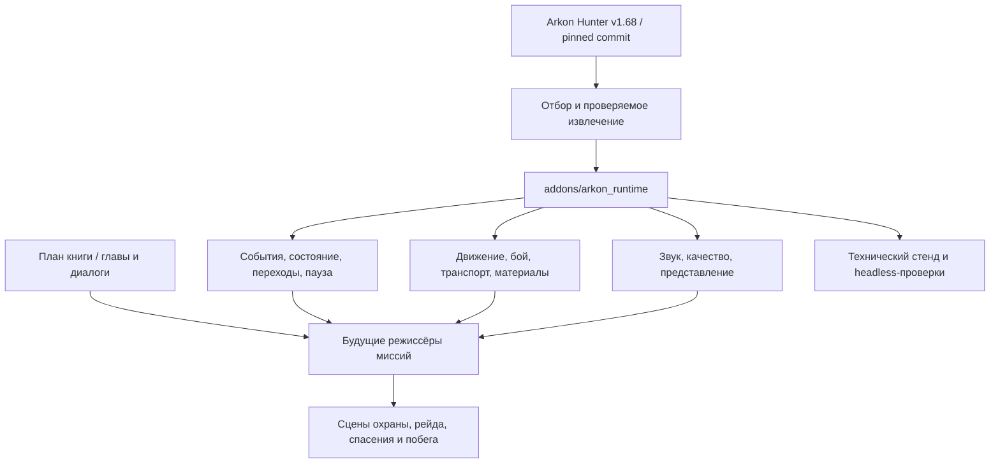

# Реализация на основе Arkon Hunter

## 1. Что в действительности представляет собой наш движок

Релиз Arkon Hunter 1.68 — проект Godot с набором собственных систем, а не отдельная модификация исходников Godot. До этой работы подсистемы были связаны путями конкретных уровней, автозагрузками, героями, ассетами и состояниями кампании. Поэтому «перенос движка» здесь означает выделение переносимого runtime, явные адаптеры и фиксацию того, что пока остаётся игровым кодом исходника.

Источник — **v1.68**, коммит **a1fd971558fcfe8d8fb99e944cc532edee5c32ba**. Из него воспроизводимо перенесены 58 файлов, в том числе 43 GDScript, 7 шейдеров, shader include, калибровочная трасса, два шрифта и их уведомления. Добавлены 7 адаптеров: состояние, переходы, таймер готовности, переносимое оружие, FPS-персонаж, последовательность диалога и временная шкала субтитров. Итого в runtime — **50 GDScript**. Это не означает готовность 50 игровых механик: часть файлов — математика, данные и небольшие проверки.

В `tools/extract_arkon_runtime.py` зафиксирован отбор и преобразования. Читается Git-дерево релиза, а не текущее состояние рабочей папки. Для каждого файла сохранены исходный и конечный SHA-256. Проверка `--verify` воспроизводит результат без записи. Новые адаптеры перечислены отдельно в `provenance/adapters.json`.

## 2. Архитектура



**Событие описывает свершившийся факт.** Режиссёр миссии не управляет чужими узлами через случайные пути. Команды остаются у владельца действия: персонаж идёт, оружие расходует патрон, дверь проверяет возможность открытия. MissionDirector получает факты `person_released`, `route_safe`, `vehicle_reached_gate`, обновляет этап и сохраняет контрольную точку.

**Данные кампании не являются адресами готовых сцен.** В текущем `campaign_plan.json` все миссии имеют `playable=false` и ожидают обсуждения. Рабочие сцены пока только редакторский план и инженерный стенд. Нельзя молча загружать одну и ту же комнату под девятью названиями и объявлять кампанию реализованной.

## 3. Перенос по подсистемам

| Подсистема | Что уже есть | Применение | Что предстоит |
|---|---|---|---|
| SignalBus, pause | Извлечённый контракт событий и центральная пауза | Разделение боя, целей, звука и интерфейса | Добавить факты новой кампании по потребности |
| Состояние | Новый адаптер по контракту GameState, атомарная запись и версия схемы | Пройденные эпизоды, сюжетные факты, настройки | Снимки позиции, NPC и дверей для боевых checkpoint |
| SceneFlow | Отделён от фиксированных level1/2/3; threaded load, завершение и ошибка | Надёжный переход к миссии и обратно | Экран ошибки/повтора и зарегистрированные реальные миссии |
| Startup gate | Политика времени из исправлений 1.68 | Пауза/фон не расходуют лимит; зависший вызов не считается пачкой нарисованных кадров | Проверка живого изображения для конкретного нового renderer |
| Здоровье / hitbox | Компоненты 2D/3D и события | Люди, мишени, дружественные и нейтральные сущности | Faction-фильтр, реакция на попадание, правила защиты заложников |
| Оружие | Каталог Resource, cooldown, отдельный запас на каждый вид | Первый прототип стрелкового боя | Перезарядка и магазин отдельно от резерва, анимации, новые звуки и модели |
| FPS и ступеньки | Перенесены математика и физические sweeps, добавлен нейтральный контроллер | Резиденция, лицей, джунгли и дом | Пригибание, укрытия и нужные интеракции; прыжок решать отдельно |
| Транспорт | Дорога, управление, контакты, трансмиссия, камера, проекции и batching | Автомобильные прототипы и погоня | VehicleSpec, масса/габариты/тормоза автобуса, водитель NPC, пассажирский огонь |
| Качество | Policy, store, monitor; контексты foot/vehicle/interior вместо номеров уровней | Единый выбор профиля | Собрать реальные бюджетные измерения для новых сцен |
| Звук | Пул SFX, один владелец музыки, передача между сценами | Шаги, оружие, радио и переходы | Пространственный бой, speech ducking, новый sound design |
| Материалы | Нейтральные кора/земля/металл/вода/листва и clip/projection код | Макеты и отдельные поверхности | Африканская растительность, архитектура, финальная цветовая схема |
| Диалог | Новый минимальный runner и данные отбора | Разговорная последовательность, один активный диалог | Блокировки ввода, локализация, озвучка и постановочные команды |
| Катсцены | Извлечён контракт декодерного времени для cues | Субтитры при паузе/seek и отсутствие второй независимой озвучки | Универсальный видеоплеер с hold/skip и новые материалы |

### Что не перенесено как «готовая человеческая система»

AI белок, их 3D-модели, садовые квесты и пазлы, контроллеры старых сюжетных героев, личные катсцены, третий уровень с его 2D-спрайтами и вся старая кампания. В старом `botanical_guard_navigation.gd` есть полезные физические проверки, но там жёсткие границы сада, типы существ и особые мост/шлюз; это материал для отдельной адаптации, а не универсальная готовая навигация людей. Портировать его целиком под новым именем было бы неверным описанием готовности.

## 4. Новые критические системы

### Люди и союзники

Нужны понятные состояния: наблюдение → тревога → занятие позиции → короткий контакт → перемещение/отход. Видимость проверяется геометрией мира, стрельба имеет ограниченную точность; AI не знает положение игрока через стены. Для союзника важнее не наступать на линию огня, проходить двери и реагировать на понятную команду, чем поддерживать десятки тактических приказов.

Первый срез ограничен двумя типами противников и одним союзником. Бюджет начальной сцены — 4–6 активных противников, 1 союзник и 2 защищаемых персонажа. Для полной кампании ориентир проверки — до 12 активных противников и 3 союзников рядом с игроком; это проверяемый верхний сценарий, не уже подтверждённая производительность.

### Эскорт Натали

Натали может перемещаться самостоятельно, искать безопасную позицию, отвечать и помогать по постановке. Команды — следовать, ждать и перейти к указанному укрытию. Её скорость зависит от состояния, но союзник не телепортируется при каждом застревании. Должны быть ручной возврат к контрольной точке и видимый статус опасности, без молчаливого бесконечного ожидания.

### Диалоги и постановка

Для каждого узла: id, говорящий, текст/локализуемый ключ, источник в книге, момент запуска, условия окончания, разрешённые уточнения, факты после завершения. История имеет один канонический позвоночник. Уточнения не подменяют согласование сюжетной развилки. Игрок может повторить важный брифинг в журнале.

Реплика заканчивается по выбранному clock: voice playback или явное подтверждение. Катсцена использует время декодера, не суммирует `delta`. При паузе не должно продолжаться второе звуковое сопровождение. Пропуск атомарно выставляет только предусмотренные факты и закрывает сцену один раз.

### Контрольные точки

Схема должна хранить версию, миссию/этап, сюжетные факты, состояние игрока, освобождённых людей, ключевые двери и позиции нужных NPC. Загруженный снимок валидируется целиком до замены текущего состояния. Старый snapshot не должен оставлять убитого врага активным или повторно выдавать событие завершения.

Текущий state-адаптер уже проверяет атомарный файл, схему и простые факты; это ещё не полный сериализатор мира. Его реализация — задача вертикального среза, а не якобы уже законченный перенос.

### Городская погоня

Перенесённая трансмиссия откалибрована под легковой автомобиль. Для автобуса нужны параметры в ресурсе: масса, размеры, центр тяжести, база, тяга, передачи и торможение. Габаритная коллизия должна учитывать корму и угол поворота. Огонь пассажира не должен менять управление машиной. Отдельно тестируются посадка, смена водителя и сохранение прогресса при смене роли.

Исходный гибрид псевдо-3D дороги и 3D-машины полезен как быстрый прототип. Для стрельбы из окон и непротиворечивых городских перекрёстков предпочтителен небольшой полноценный 3D-маршрут. Окончательный выбор делается по результату одного прототипа, а не обещанием заранее.

## 5. Рендер и бюджет

Текущая основа использует GL Compatibility — это соответствует переносимому профилю исходной игры и позволяет проверять Windows/Linux и ограниченные устройства. Уровень качества создают согласованные материалы, умеренная палитра, читаемый свет, хорошая постановка и достаточная плотность ключевых объектов. Большая ночная неоновая подсветка сада в африканскую резиденцию не переносится.

Для первого среза: один интерьер с небольшим двором, 1–2 ключевых источника с тенями, заранее ограниченная видимость, без SSR, тяжёлого GI и декоративной толпы. Затем измеряем медиану и p95 времени кадра, загрузки и потребление памяти. Цели для проверки: 60 FPS на целевой настольной машине; отдельный облегчённый профиль 30 FPS при дальнейшем решении делать мобильную версию. Эти цифры не результаты уже выполненного GPU-теста.

Исходный GraphicsSettings не включает runtime-адаптацию для Linux: его измерительные допуски ограничены Android/iOS/Windows. В новом проекте это сохранено и явно отмечено. Linux/PS5 нужно проверять на реальном устройстве; headless Linux не доказывает ни 60, ни 120 FPS и не снимает ограничений драйвера.

Переход на Forward+ возможен отдельным профилем после сравнения на настоящей сцене. Не надо умножать варианты renderer до появления корректного боевого среза.

## 6. Структура проекта

```text
white_guard/
  addons/arkon_runtime/    переносимые системы и адаптеры
  assets/reused/fonts/    только подходящие шрифты и лицензии
  data/                   план кампании и отбор диалогов
  docs/                   постановочный и технический план
  provenance/             источники, SHA-256, границы переноса
  scenes/                 планировочная комната и стенд
  scripts/                код редакторского стенда
  tests/                  поведенческие проверки
  tools/                  воспроизводимое извлечение и аудит
```

Материалы `ps5-hfr1/` и отчёт PS5 в корне Kisa принадлежат прежней задаче и не являются зависимостями игры. Корневой репозиторий уже был публичным; в новую папку попадает только отобранный деперсонализированный runtime и указанная документация.

## 7. Проверка и границы результата

Проверено на Godot **4.6.3 stable**: импорт проекта; 88 поведенческих и загрузочных проверок, включая реальный переход между сценами, физический raycast в hitbox, изоляцию патронов, состояние здоровья, сохранение, паузу/фон таймера, проекцию, трансмиссию, cues и диалог. Объявление исходного проекта 1.68 содержит feature 4.7; переносимый набор проверен отдельно на 4.6.3. Для 4.7 отдельный запуск пока не заявлен.

Наличие ресурсов, хешей и данных глав проверяется Python-аудитом. Эти проверки не доказывают качество будущих боёв, актёрскую игру или производительность на телефоне/PS5. Основная кампания остаётся планом.
