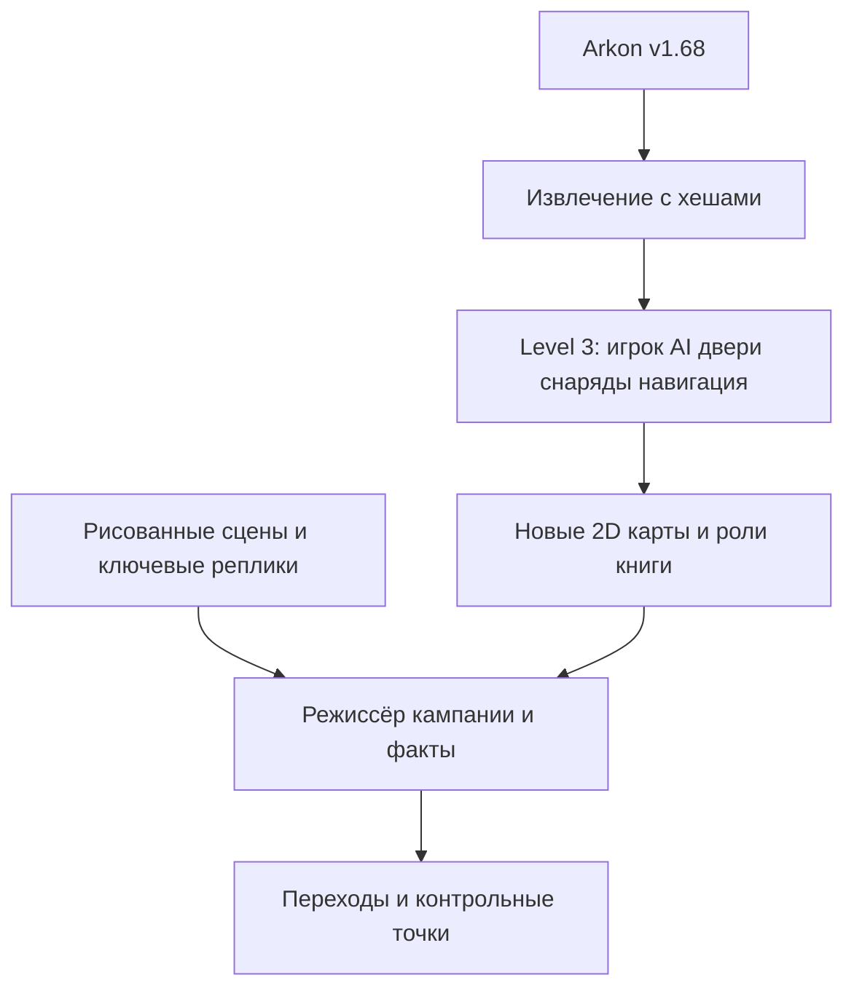

# Реализация на основе третьего уровня Acorn Hunter

## 1. Принятые решения и происхождение

Основной игровой формат — **2D топ-даун шутер на системах Level 3**. Основной лор — простые рисованные сцены по примеру **This Is the Police**. Два игровых исключения пока не назначены. Ранее предложенный основной FPS заменён этим решением пользователя.

Наш движок — набор систем поверх Godot, а не отдельный renderer. Источник закреплён на **Arkon v1.68**, коммит **a1fd971558fcfe8d8fb99e944cc532edee5c32ba**. Из него воспроизводимо извлечены **77 файлов**. Для каждого записаны исходный SHA-256, конечный SHA-256 и преобразования. Копирование идёт из Git-дерева релиза, не из изменяемого рабочего каталога.

Добавленный набор Level 3: **10 исходных GDScript, 5 сцен, 3 ресурса оружия и 19 выбранных методов Level3Store в отдельном хосте**. Остальные перенесённые библиотеки остаются доступны, но наличие 3D и автомобильных модулей не выбирает формат исключений за автора.

## 2. Что сохраняется из Level 3

| Система | Перенесённое поведение | Изменение для стенда |
|---|---|---|
| Игрок | CharacterBody2D; нормализация ввода; движение, прицел, огонь, бег, однократные action/throw | Нейтральная геометрия вместо личной героини; убрана визуальная подвеска конусомёта |
| Базовые параметры | Скорость 120, бег ×1,18, разгон 900, торможение 1100; радиус тела 7 | Значения не перенастраивались |
| Здоровье | 100 у игрока, 0,24 с неуязвимости; смерть один раз | Это исходный баланс, а не обещание «один выстрел всегда убивает игрока» |
| Оружие | Пистолет 0,28 с; дробовик 0,72 с и пять направлений; бита 0,38 с | Названия и изображения нейтральные; сцена игрока сохраняет infinite_ammo=true из релиза |
| Снаряды | Swept ray между позициями каждого шага; исключение стрелка; однократное попадание и возврат в пул | Статичная заглушка вместо анимационного стрипа |
| Попадание | Пистолет/дробовик через исходный callback; отдельный cache попаданий дробовика; вражеская пуля 380 ед/с, урон 8 | Визуальные эффекты выдаются событиями, старые звуки не подключены |
| Враг | IDLE/ALERT/STUNNED/DEAD; видимость по физике; шум; последний контакт; дистанция атаки; замах; обязанности комнаты | Старый animator заменён адаптером; решения AI сохранены |
| Навигация | AStarGrid2D, шаг 12; радиус проверки 8; стены по настоящей физике; послойная подготовка | Карта стенда своя; двери исключаются из планирования пути и открываются локально |
| Двери | Разные скорости открытия/удара/закрытия; оглушение от удара; запрет закрыть коллайдер на актёре | Нейтральная текстура; положение двери задано до добавления в физический мир |
| Предметы | Ручной подбор оружия и бутылки; автоматическая аптечка; проверка видимости; повторная проверка раненого на аптечке | Каталог сцены новый; сохранено лечение +35 |
| Пул | Прогрев 24 снарядов, максимум 64, переработка вместо постоянного создания | Принадлежит текущей сцене |
| Данные карты / touch | Исходный ресурс сетки и логика джойстика | Джойстик перенесён как модуль; мобильная раскладка ещё не подключена |

Названия классов получили префикс Arkon, пути перенесены в addon. Логика из исходного Level3Store выбирается инструментом по именам методов, а не переписывается на похожую. Хост задаёт карту, игрока, коллекции дверей/врагов/предметов, доступность боя и визуальные события. Старые пицца, кафе, кассеты, рейд белок и семейные реплики в него не включены.

Это **перенос ядра**, а не побайтовая копия старой игры. В стенде используются новая маленькая карта, обзорная камера и кнопка запуска AI. Исходная сцена игрока сохраняет Camera2D и её настройки; итоговые границы/ведение камеры выбираются при постановке карты. Человеческие анимации ещё не сделаны.

## 3. Рисованные сценки

Новый `narrative/illustrated_sequence.gd` хранит порядок панелей, минимальное время чтения и факты завершения. Ввод переводит на следующую панель; пауза останавливает отсчёт. Пропуск выдаёт те же факты, что обычное завершение, ровно один раз. Неправильные данные не уничтожают уже запущенную последовательность. Сам читатель не пишет прогресс: это обязанность режиссёра сцены, когда игровая кампания появится.

`illustration_lab.tscn` демонстрирует три текстовые панели договора с Леоном. Цветные блоки — обозначенные места для будущих рисунков; это не готовая художественная катсцена. Реплики — адаптационные наброски, не цитаты из книги. Пока нет озвучки, таймлайна звуков, параллакса, сохранения внутри сцены или окончательной схемы иллюстрационных слоёв.

Для производства: один фон и 2–3 фигуры на разговор; смена общего/среднего/детали; простые склейки и затемнения; отдельные слои только там, где это помогает сцене. Гранату в букете и телефон Татьяны показываем отдельными вставками. Основной рассказ не требует видеогенерации или анимированных 3D лиц.

## 4. Что добавляется к существующему бою

| Новая задача книги | Реализация поверх Level 3 | Что проверять |
|---|---|---|
| Союзник | Роль и цели поверх существующего перемещения/LOS; отдельный список допустимых целей | Не стреляет в защищаемых; проходит дверь; не блокирует маршрут |
| Натали и заложники | Небольшие состояния: ждёт, следует, укрывается, достигла зоны | Нет телепорта через стену; не застревает в дверях; смерть/повтор дают понятный исход |
| «Букет» | Тот же игрок с combat_enabled=false; наблюдение, подход, контекстный предмет | Гражданские не становятся противниками; важная деталь читается через рисунок |
| Сценарные фазы | Задачи, триггеры, входные/выходные факты, безопасные точки | Переход и выдача награды один раз; пропуск сценки не теряет обязательный факт |
| Контрольная точка | К существующему атомарному прогрессу добавить конкретное состояние карты/актёров/дверей | Загрузка не дублирует предметы и не ломает эскорт |
| Два исключения | Отдельные ограниченные режимы после назначения эпизодов автором | Не требуют менять основной контроллер всех карт |

Не требуется создавать нового основного боевого противника с нуля: используется AI Level 3. Требуются человеческие спрайты, реакции и дополнительные роли союзников/нейтральных, которых старый набор не даёт автоматически.

## 5. Структура и переходы

Рабочие сцены сейчас: просмотр плана, 2D стенд и макет сценок. `campaign_plan.json` содержит предложения, а не адреса девяти готовых уровней: все `playable=false`. Направление формата отдельно отмечено `user_confirmed`; состав эпизодов и два исключения остаются на обсуждении.

Состояние/сохранения, переходы, foreground-таймер, аудиопул, шрифты и профили графики перенесены ранее. FPS-адаптер и автомобильная библиотека остаются резервными инструментами. Они не входят в основной маршрут проверки боя и не обозначают уже выбранные специальные уровни.

## 6. Рендер и проверка

Основной мир — Node2D, спрайты и небольшие связанные карты. Без обязательной 3D сцены для каждого разговора стоимость контента существенно ниже. Это не доказательство конкретного FPS: отдельно измеряем время кадра, память, загрузку карты и число активных врагов/снарядов на целевом устройстве.

Перенос проверяется на **Godot 4.6.3 stable / GL Compatibility**. В исходном проекте указан feature 4.7; совместимость с 4.7 отдельным запуском не заявляется. Исходная автоматическая адаптация GraphicsSettings не распространяется на Linux/PS5; сохранение библиотеки не снимает это ограничение. X11/llvmpipe подтверждает отображение стендов, а не производительность PS5.

Подробные результаты — в `VALIDATION.md`; оригинальный релиз 1.68 и его готовые APK/ZIP не изменяются.
